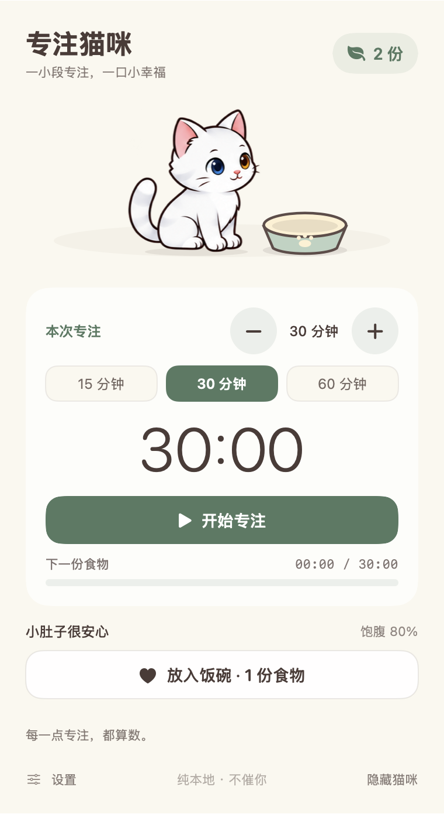
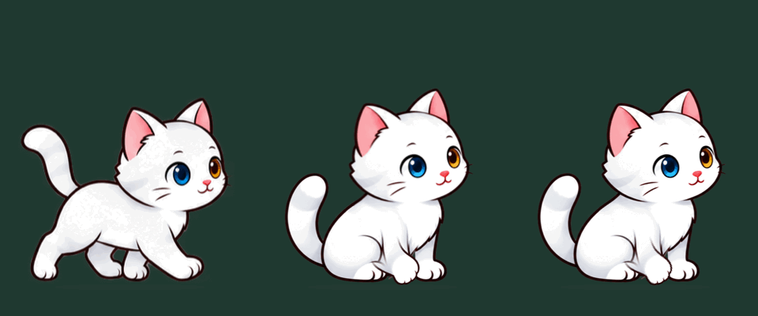
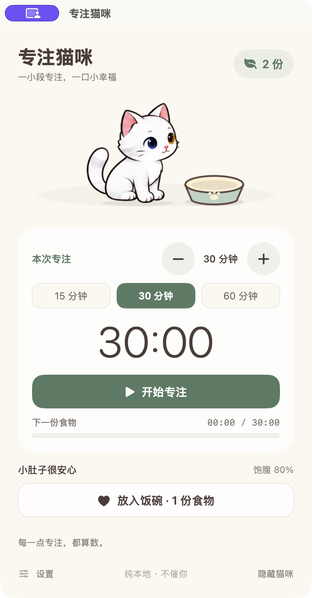
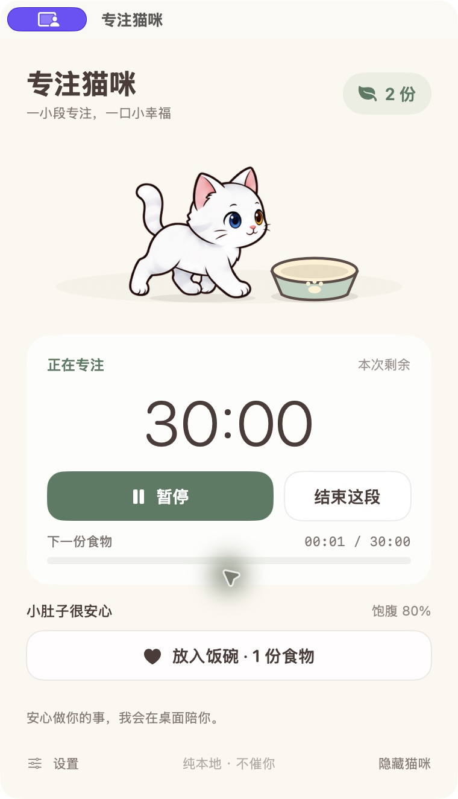
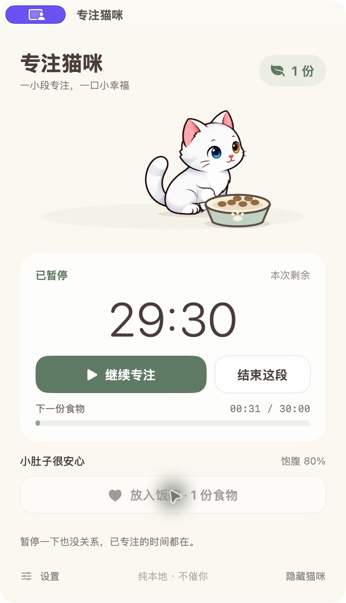
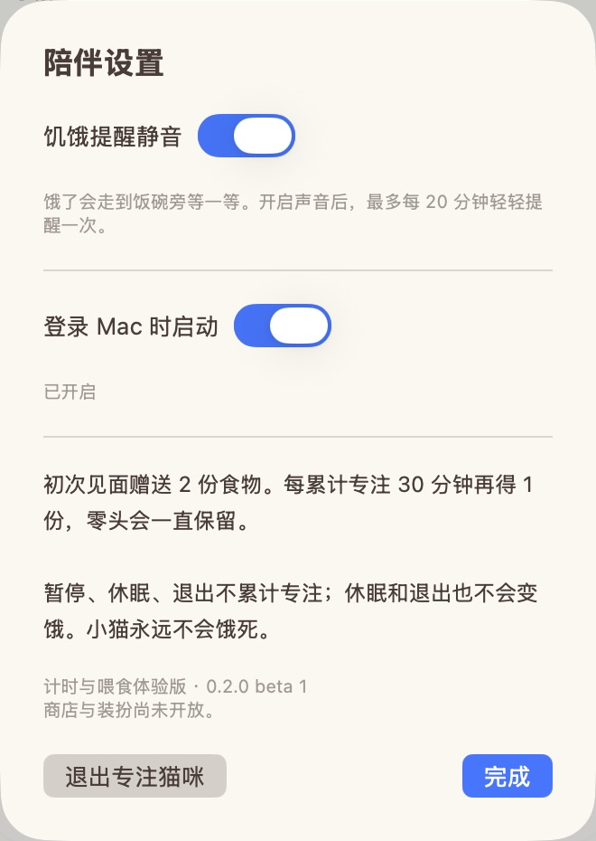

# 专注猫咪 · FocusCat

**[下载 0.2.0-beta.1 体验版](https://github.com/janiezhang52-lab/focuscat/releases/tag/v0.2.0-beta.1)**

一只住在 Mac 桌面上的白色异瞳小猫。开始一段专注，慢慢积攒食物，再放进饭碗喂它。

上方面板图由应用自身视图直接导出，展示中文界面；不是全桌面截图。

**当前版本：0.2.0-beta.1，体验版。** 面向 Apple Silicon（M 系列）Mac，系统目标为 macOS 13 或更新版本。目前仅在开发用 Mac 上测试，尚未完成多机型、各系统版本验证。

## 下载与安装

打开 **[0.2.0-beta.1 版本页](https://github.com/janiezhang52-lab/focuscat/releases/tag/v0.2.0-beta.1)**，或使用下方直接下载链接。DMG 和 ZIP 包含同一个应用，任选一种：

- [下载 DMG](https://github.com/janiezhang52-lab/focuscat/releases/download/v0.2.0-beta.1/FocusCat-0.2.0-beta.1-macOS-arm64.dmg)：打开后，将“专注猫咪”拖入“应用程序”。
- [下载 ZIP](https://github.com/janiezhang52-lab/focuscat/releases/download/v0.2.0-beta.1/FocusCat-0.2.0-beta.1-macOS-arm64.zip)：解压后，将“专注猫咪.app”拖入“应用程序”。
- [SHA256SUMS.txt](https://github.com/janiezhang52-lab/focuscat/releases/download/v0.2.0-beta.1/SHA256SUMS.txt)：安装包的 SHA-256 校验值。

本版使用临时签名（ad-hoc），未经过 Apple 公证。首次从互联网下载后，可能被 macOS 门禁（Gatekeeper）拦截。请先看[安装说明](docs/INSTALL.md)；如果系统提示“已损坏”或“将损坏你的电脑”，请停止打开并反馈。

## 可以做什么

- **专注计时**：默认 30 分钟，可选 15 / 30 / 60 分钟，或按分钟调整。支持暂停、继续和提前结束。
- **积攒食物**：每累计专注 30 分钟获得 1 份食物，零头跨次保留。初次使用赠送 2 份。
- **照顾小猫**：点“放入饭碗”消耗 1 份食物，小猫会走过去吃；饭碗和猫都能拖动。
- **桌面陪伴**：小猫会散步、张望、洗脸、趴卧、伸懒腰、睡觉，偶尔撒欢。
- **本地保存**：计时进度、食物、位置和设置自动保存，无需账号或网络。

上方 GIF 使用与本版相同的猫咪素材，按固定顺序绘制动作，供查看外观和动作效果；它不是桌面实录。

小猫位于桌面层，普通工作窗口可以盖住它。点击小猫或菜单栏图标打开面板；关闭面板后仍会运行。彻底退出请在菜单栏或设置里选择“退出专注猫咪”。

暂停、休眠和退出都不累计专注；休眠或重开后需要手动继续。饥饿只随应用清醒运行时间变化，小猫不会饿死。饥饿提醒默认静音，**首次安装默认不启用登录启动**；需要时可在设置中主动开启。

## 实际运行截图

以下为体验版实际运行时的应用窗口截图，使用独立测试存档，界面为中文。

| 专注面板 | 专注计时中 |
| --- | --- |
|  选择 30 分钟，初次赠送 2 份食物。 |  开始专注后可随时暂停，已累计时间保留。 |
| **喂食**  向饭碗放入 1 份食物，库存剩余 1 份。 | **陪伴设置**  静音、登录启动、版本信息与退出入口。 |

设置图的登录启动已开启，来自测试 Mac 旧版保留的登录项；**首次安装默认关闭**。图中的紫色标记和指针高亮来自截图工具，不是应用功能或权限要求。

## 当前范围

Windows、Intel Mac 暂未支持。商店、换装、零食和睡垫尚未开放；没有自动更新。部分动作衔接仍有短暂轮廓变化或叠影。小猫在启动时选定的一个屏幕上活动，不支持跨屏漫游；外接屏切换与系统升级后的行为尚待验证。

详见[已知问题](docs/KNOWN_ISSUES.md)、[权限说明](docs/PERMISSIONS.md)、[隐私说明](docs/PRIVACY.md)和[版本说明](RELEASE_NOTES.md)。反馈问题请使用仓库的 **Issues → Bug report**，说明复现步骤、Mac 芯片和 macOS 版本，并遮挡截图中的个人信息。

## 制作与仓库范围

本项目使用了 AI 辅助。猫咪图集由 OpenAI 图像生成工具生成和修改，代码与说明文字也有 AI 辅助；应用运行时不连接 AI 服务。

本仓库用于提供发布资料和安装包，应用源码尚未公开。本仓库未授予源码或素材的开源许可。
